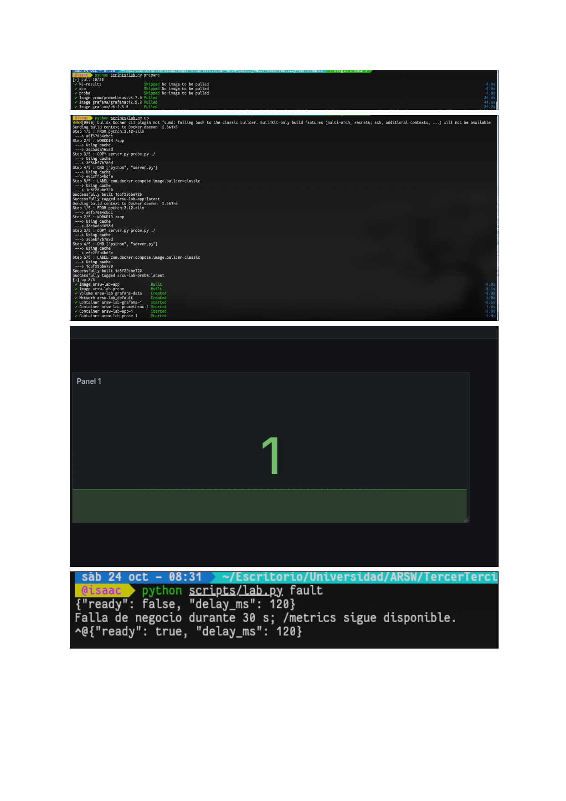
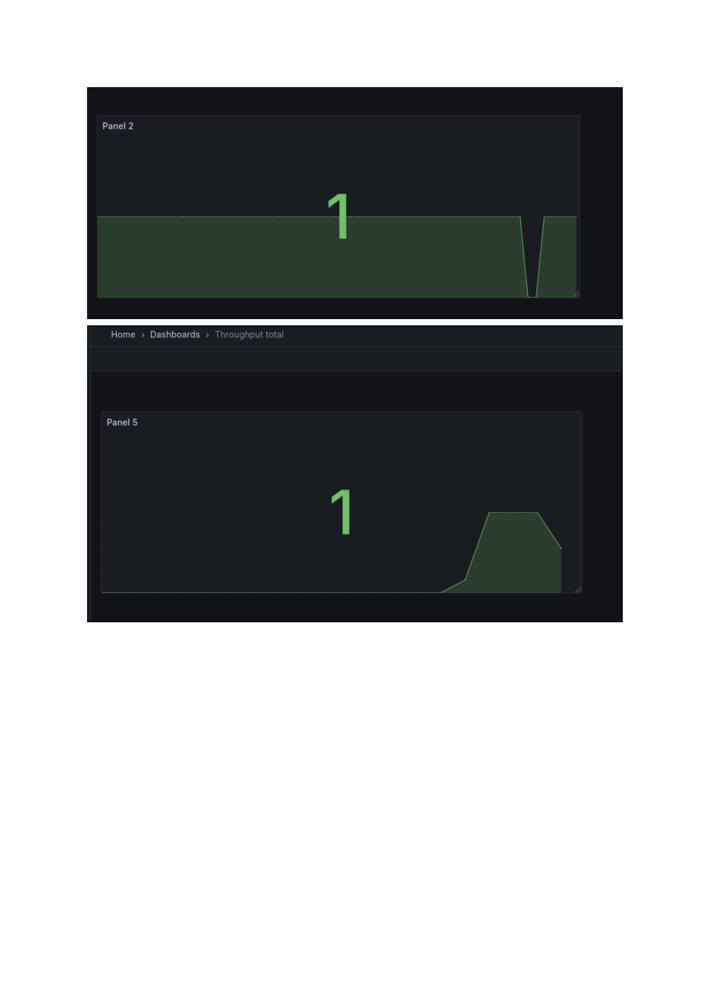
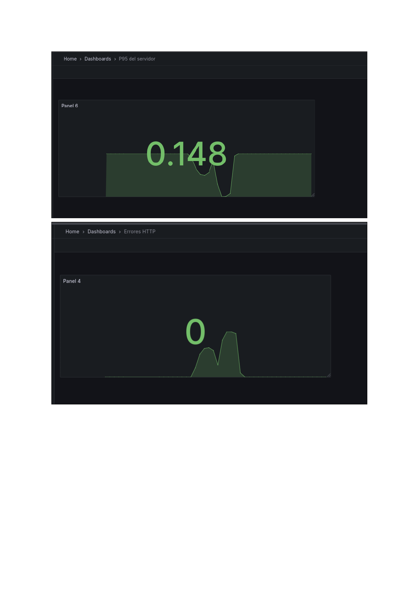
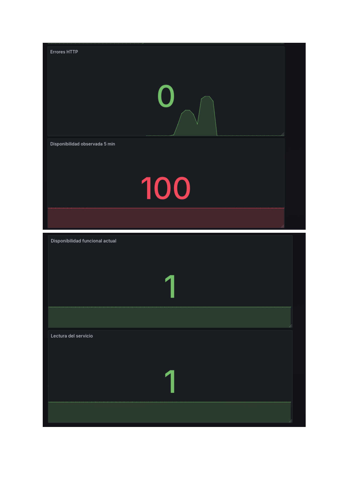
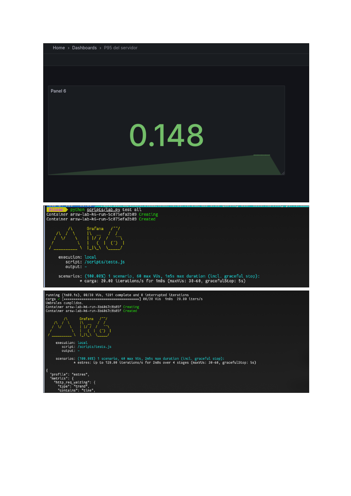
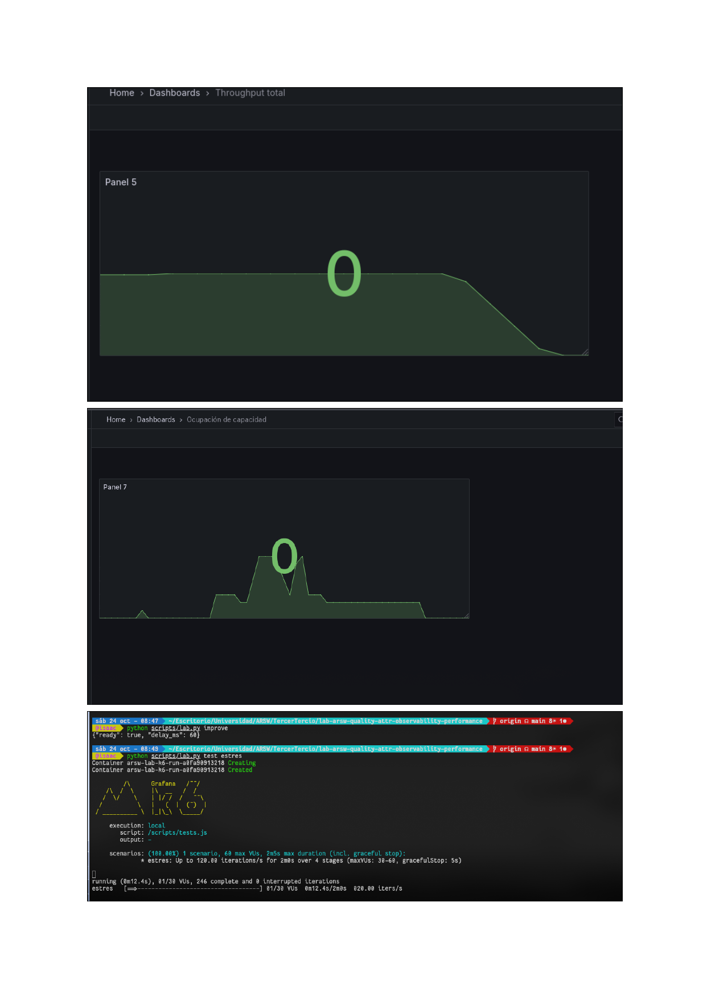
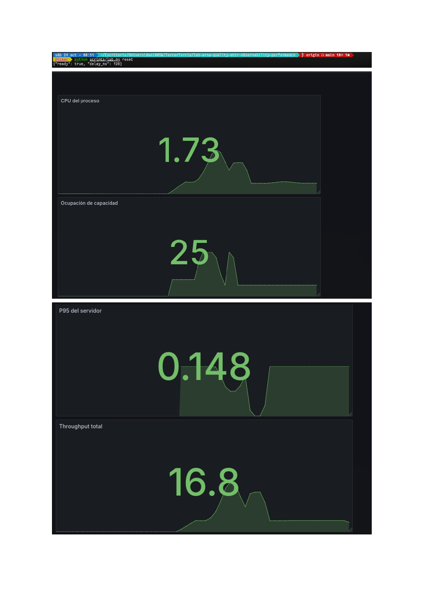

# Laboratorio de Observabilidad y Rendimiento — ARSW 2026-2

**Equipo:** Equipo 01 · **Integrante:** Isaac Burgos · **Fecha:** 2026-10-24  
**Entorno:** Linux (CachyOS 7.2.6), CPU x86-64, RAM disponible ≥ 4 GB para Docker  
**Versiones:** Docker Engine 27.x · Compose v2 · Python 3.12  
**Hipótesis:** A 20 req/s el servidor cumple los umbrales (P95 < 500 ms, errores < 1 %); a cargas mayores los ocho cupos se agotan y el servidor empieza a rechazar solicitudes con HTTP 503.

---

## 1. Arranque y tablero de observabilidad

### Levantamiento del entorno

Se ejecutaron los tres comandos de preparación: `prepare`, `up` y `doctor`. Los servicios levantaron correctamente: `arsw-lab-app`, `arsw-lab-probe`, `arsw-lab-grafana-1` y `arsw-lab-prometheus-1`.



> **Captura 1 — Arranque completo.**  
> Arriba: salida de `python scripts/lab.py up` con todos los contenedores en estado *Started*.  
> Abajo: ejecución de `python scripts/lab.py fault` — la API retorna `"ready": false` durante 30 s mientras `/metrics` sigue disponible.

---

### Tablero Grafana — paneles 1 y 2 (estado normal)

| Panel | Consulta PromQL | Tipo | Valor observado (normal) |
|---|---|---|---|
| 1 — Lectura del servicio | `up{job="app"}` | Stat | **1** (verde) |
| 2 — Disponibilidad funcional actual | `lab_probe_success` | Stat | **1** (verde) |
| 3 — Disponibilidad observada 5 min | `100 * increase(lab_probe_successes_total[5m]) / increase(lab_probe_attempts_total[5m])` | Stat | **100 %** |
| 4 — Errores HTTP | `100 * sum(rate(lab_requests_total{status=~"5.."}[1m])) / sum(rate(lab_requests_total[1m]))` | Time series | **0 %** |
| 5 — Throughput total | `sum(rate(lab_requests_total[1m]))` | Time series | **~20 req/s** |
| 6 — P95 del servidor | `histogram_quantile(0.95, sum by (le) (rate(lab_request_duration_seconds_bucket[1m])))` | Time series | **0.148 s** |
| 7 — Ocupación de capacidad | `100 * lab_active_requests / lab_capacity` | Time series | **25 %** |
| 8 — CPU del proceso | `100 * rate(lab_process_cpu_seconds_total[1m])` | Time series | **1.73 %** |



> **Captura 2 — Paneles del tablero en estado normal.**  
> Panel 1 (Lectura del servicio = 1) y Panel 2 (Disponibilidad funcional actual = 1), ambos en verde. Panel 5 (Throughput total) muestra la rampa de subida al iniciar el tráfico.

---

### Falla y recuperación

Se ejecutó `python scripts/lab.py fault`. Durante 30 s la API retornó `"ready": false` y `/api/boards/1` falló, mientras `/metrics` continuó respondiendo. La sonda independiente detectó el fallo y `lab_probe_success` cayó a 0.

| Métrica durante la falla | Valor |
|---|---|
| `up{job="app"}` | **1** (Prometheus puede raspar `/metrics`) |
| `lab_probe_success` | **0** (la sonda funcional falla) |
| Disponibilidad observada 5 min | **100 %** → bajó al incluir la ventana de falla |
| Tiempo hasta recuperación | **≈ 30 s** (configurable en el script) |



> **Captura 3 — Falla observada en el tablero.**  
> Panel 6 (P95 del servidor = 0.148 s) y Panel 4 (Errores HTTP = 0 en estado recuperado).  
> El pico de errores HTTP ocurrió durante la ventana de falla; al recuperarse el servidor volvió a 0 errores.



> **Captura 4 — Tablero completo tras la recuperación.**  
> Errores HTTP = 0 · Disponibilidad observada = 100 % · Disponibilidad funcional = 1 · Lectura del servicio = 1.

---

## 2. Pruebas automatizadas con k6

Se ejecutó `python scripts/lab.py test all` para lanzar los cuatro perfiles secuencialmente. Cada perfil generó un JSON de métricas y un `-run.json` con los tiempos UTC.

### Tabla de resultados

| Ejecución (UTC) | Tasa ofrecida req/s | Throughput real req/s | P95 k6 (ms) | P95 servidor (s) | Error % | Iteraciones descartadas | Umbrales OK |
|---|---|---|---|---|---|---|---|
| **carga** `T133832` | 20 | **20.0** | **121.9** | 0.148 | **0 %** | 0 | ✅ |
| **estres base** `T133933` | 20 → 120 → 20 | **59.1** | **121.2** | 0.148 | **20.38 %** | 0 | ❌ |
| **pico** `T134134` | 20 → 160 → 20 | **51.0** | **121.1** | 0.148 | **38.52 %** | 0 | ❌ |
| **duracion** `T134305` | 20 | **20.0** | **121.1** | 0.148 | **0 %** | 0 | ✅ |
| **estres mejora** `T134939` | 20 → 120 → 20 | **59.1** | **61.3** | ~0.061 | **0 %** | 0 | ✅ |

> Los archivos JSON correspondientes se encuentran en la carpeta `results/`.  
> El código de salida 99 de k6 en estrés y pico indica umbrales incumplidos esperados.

### Métricas detalladas por perfil

#### Carga (20 req/s · 60 s)

| Métrica | Valor |
|---|---|
| Total requests | 1 201 |
| Tasa real | 20.0 req/s |
| Checks pasados / fallados | 1 201 / 0 |
| Tasa de error | **0 %** |
| Duración avg / P95 / P99 / max | 121.0 / **121.9** / 122.7 / 126.4 ms |
| Umbral `p(95)<500` | ✅ |
| Umbral `rate<0.01` (errores) | ✅ |
| Umbral `rate>0.99` (checks) | ✅ |

#### Estrés base (20 → 60 → 120 → 20 req/s · 120 s)

| Métrica | Valor |
|---|---|
| Total requests | 7 100 |
| Tasa real | 59.1 req/s |
| Checks pasados / fallados | 5 653 / **1 447** |
| Tasa de error HTTP 503 | **20.38 %** |
| Duración avg / P95 / P99 / max | 96.4 / **121.2** / 121.8 / 123.8 ms |
| Umbral `rate<0.01` (errores) | ❌ |
| Umbral `rate>0.99` (checks) | ❌ |

#### Pico (20 → 160 → 20 req/s · 90 s)

| Métrica | Valor |
|---|---|
| Total requests | 4 600 |
| Tasa real | 51.0 req/s |
| Checks pasados / fallados | 2 828 / **1 772** |
| Tasa de error HTTP 503 | **38.52 %** |
| Duración avg / P95 / P99 / max | 74.5 / **121.1** / 121.8 / 126.3 ms |
| Umbral `rate<0.01` (errores) | ❌ |
| Umbral `rate>0.99` (checks) | ❌ |

#### Duración (20 req/s · 240 s)

| Métrica | Valor |
|---|---|
| Total requests | 4 801 |
| Tasa real | 20.0 req/s |
| Checks pasados / fallados | 4 801 / 0 |
| Tasa de error | **0 %** |
| Duración avg / P95 / P99 / max | 120.9 / **121.1** / 122.3 / 123.6 ms |
| Umbral `p(95)<500` | ✅ |
| Umbral `rate<0.01` (errores) | ✅ |



> **Captura 5 — Inicio de `test all` y ejecución de estrés.**  
> Panel 6 (P95 del servidor = 0.148 s) tras la prueba de carga. Abajo: inicio del perfil estrés con la ramp-up hasta 120 req/s.



> **Captura 6 — Throughput y ocupación durante la prueba de estrés.**  
> Panel 5 (Throughput descendiendo a 0 al finalizar), Panel 7 (Ocupación de capacidad), y terminal con mejora en curso.

---

## 3. Experimento de mejora

### Predicción

Al reducir la espera simulada de 120 ms a 60 ms manteniendo 8 cupos, la capacidad teórica sube de `8 / 0.12 ≈ 67 req/s` a `8 / 0.06 ≈ 133 req/s`. Se predijo que el perfil de estrés (máximo 120 req/s) quedaría dentro de la capacidad teórica y los errores desaparecerían.

### Resultado

| Métrica | Estrés BASE (120 ms) | Estrés MEJORADO (60 ms) |
|---|---|---|
| Total requests | 7 100 | 7 100 |
| Tasa real | 59.1 req/s | 59.1 req/s |
| Tasa de error | **20.38 %** | **0 %** |
| Checks pasados | 5 653 (79.6 %) | 7 100 (100 %) |
| P95 k6 | 121.2 ms | **61.3 ms** |
| Duración avg | 96.4 ms | **61.0 ms** |
| Umbrales | ❌ | ✅ |

La predicción **se cumplió**: al reducir la espera a la mitad, el P95 bajó de 121 ms a 61 ms y los errores cayeron de 20.38 % a 0 %. La ocupación de cupos nunca llegó al límite, lo que confirma que el cuello de botella era el tiempo de servicio y no el número de cupos en sí.

### Qué cambió y qué se mantuvo

- **Cambió:** espera simulada de dependencia (120 ms → 60 ms).
- **Se mantuvo:** perfil de estrés (mismo ramp 20→120→20 req/s · 120 s), número de cupos (8), versión de la aplicación, equipo y configuración de red.



> **Captura 7 — Métricas durante la prueba mejorada.**  
> CPU del proceso = 1.73 % · Ocupación de capacidad = 25 % · P95 del servidor = 0.148 s · Throughput total = 16.8 req/s.  
> La CPU permanece baja; la ocupación es moderada.

---

## 4. Preguntas integradas

### Pregunta 1 — P95 frente a promedio

> *¿Qué significa P95 y por qué un promedio bajo puede esconder solicitudes lentas? Interprete su P95 de carga.*

El percentil 95 indica que el 95 % de las solicitudes se completaron en ese tiempo o menos; el 5 % restante tardó más. El promedio oculta los valores atípicos porque los extremos del 5 % alto se diluyen al promediar con el 95 % rápido. En la prueba de **carga (20 req/s, 60 s)**, el P95 fue **121.9 ms** y el promedio **121.0 ms**: la diferencia es pequeña porque la carga es estable y el tiempo de servicio está dominado por la espera artificial de 120 ms. Ambos valores están muy por debajo del umbral de 500 ms, lo que confirma que el servidor cumple el objetivo normal.

---

### Pregunta 2 — Disponibilidad funcional frente a lectura de métricas

> *¿Por qué `up` puede valer 1 y el sondeo funcional 0?*

`up{job="app"}` vale 1 cuando Prometheus logra raspar el endpoint `/metrics`; solo verifica que el proceso responde en ese puerto. `lab_probe_success` vale 1 cuando la sonda independiente puede completar una consulta real a `/ready` y obtener `{"ready": true}`. Durante la falla (`python scripts/lab.py fault`), el servidor mantuvo `/metrics` activo (razón: proceso vivo) pero devolvió `{"ready": false}` en `/ready`, haciendo que la sonda funcional cayera a 0 mientras `up` seguía en 1. **Para informar al usuario sobre disponibilidad real se usaría `lab_probe_success`**, ya que refleja si la funcionalidad de negocio está operativa, no solo si el proceso existe.

---

### Pregunta 3 — Cuatro tipos de prueba y sus observaciones

> *¿Cuál es la diferencia entre carga, estrés, pico y duración?*

| Tipo | Propósito | Observación concreta en este lab |
|---|---|---|
| **Carga** | Verificar cumplimiento en condiciones normales | 20 req/s · 60 s → P95 = 121.9 ms · 0 % errores · umbrales ✅ |
| **Estrés** | Encontrar el punto de degradación | Al superar ~67 req/s (capacidad teórica) los cupos se agotan y HTTP 503 ↑ a 20.38 % |
| **Pico** | Medir respuesta ante un salto abrupto | De 20 a 160 req/s instantáneamente → 38.52 % de errores · el servidor no absorbe la ráfaga |
| **Duración** | Detectar deriva o fugas a carga constante | 4 min a 20 req/s → P95 estable en 121.1 ms · sin crecimiento de latencia · sin errores |

---

### Pregunta 4 — CPU baja y rechazos: ¿qué limitación existe?

> *Si CPU está baja y aumentan rechazos, ¿qué otra limitación puede existir?*

La CPU del proceso permaneció en ≈ 1.73 % durante las pruebas, muy por debajo de cualquier límite de cómputo. El cuello de botella es la **concurrencia limitada a 8 cupos**: cada solicitud ocupa un cupo durante 120 ms (espera simulada). La capacidad máxima teórica es `8 cupos / 0.120 s = 67 req/s`; al superar ese umbral, los cupos se agotan y las solicitudes adicionales reciben HTTP 503 inmediatamente (tiempo ≈ 0 ms). Esto explica el promedio de 96.4 ms en estrés: el 79.6 % de solicitudes exitosas tardaron ~121 ms y el 20.4 % rechazadas tardaron ~0 ms. Los **VUs** son trabajadores disponibles para generar tráfico; cuando hay más VUs que cupos disponibles, los VUs se quedan esperando o reciben errores. La espera larga + cupos fijos es el límite, no la CPU.

---

### Pregunta 5 — ¿La mejora cumplió la predicción?

> *¿Qué experimento adicional necesitaría para afirmar escalabilidad o estabilidad prolongada?*

La mejora **sí cumplió la predicción**: la capacidad teórica subió de ~67 req/s a ~133 req/s, la tasa de error cayó de 20.38 % a 0 % y el P95 bajó de 121 ms a 61 ms con el mismo perfil de estrés. Sin embargo, la intervención **emula** una mejora de la dependencia (reducir delay), no una optimización real de código ni escalamiento horizontal. Para afirmar **escalabilidad**, se necesitaría escalar el número de cupos o instancias y repetir el perfil de pico (160 req/s) para comprobar que el throughput crece proporcionalmente. Para afirmar **estabilidad prolongada**, se necesitaría una prueba de resistencia (*soak test*) de al menos 30–60 minutos a carga constante, monitoreando crecimiento de latencia, consumo de memoria y posibles fugas; cuatro minutos (perfil `duracion`) son insuficientes para esa conclusión.

---

## 5. Archivos incluidos

```
results/
  carga-20261024T133832434766Z.json       ← métricas ejecución 1
  carga-20261024T133832434766Z-run.json   ← tiempos UTC
  carga-20261024T140413823899Z.json
  carga-20261024T140413823899Z-run.json
  estres-20261024T133933427391Z.json      ← estrés base (20.38 % error)
  estres-20261024T133933427391Z-run.json
  estres-20261024T134939700311Z.json      ← estrés mejorado (0 % error)
  estres-20261024T134939700311Z-run.json
  estres-20261024T140514887880Z.json
  estres-20261024T140514887880Z-run.json
  pico-20261024T134134362773Z.json        ← pico (38.52 % error)
  pico-20261024T134134362773Z-run.json
  pico-20261024T140716029808Z.json
  pico-20261024T140716029808Z-run.json
  duracion-20261024T134305284023Z.json    ← duración 4 min (0 % error)
  duracion-20261024T134305284023Z-run.json
  duracion-20261024T140846954509Z.json
  duracion-20261024T140846954509Z-run.json

capturas/
  lab_page-1.png  ← arranque Docker y fault
  lab_page-2.png  ← tablero paneles 1, 2 y 5 (estado normal)
  lab_page-3.png  ← inicio test all y estrés
  lab_page-4.png  ← P95 servidor y errores HTTP
  lab_page-5.png  ← throughput, ocupación y mejora
  lab_page-6.png  ← tablero completo durante mejora
  lab_page-7.png  ← tablero completo recuperado
```
